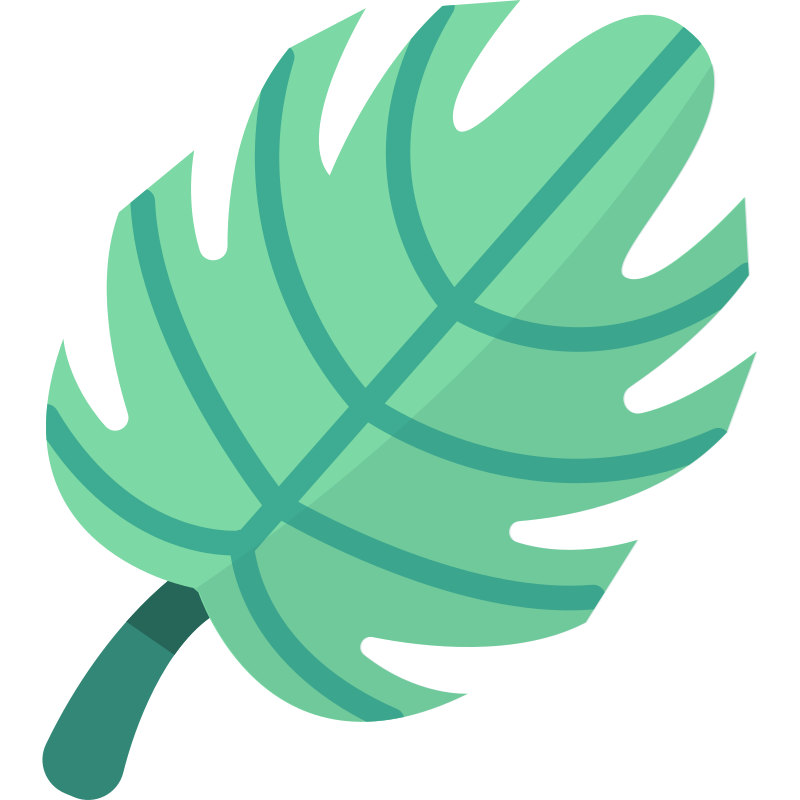

# <p align="center"><br/>Neural Genesis</p>

<p align="center">
  <strong>Local-first, encrypted markdown knowledge workbench with deterministic Model Context Protocol (MCP) bridges.</strong>
</p>

<p align="center">
  
  
  
  
  
  
  <a href="https://github.com/ncrobin777/Neural-Genesis/releases"></a>
</p>

<p align="center">
  <a href="https://github.com/ncrobin777/Neural-Genesis/releases/latest"><strong>⬇️ Download Windows Installer (.exe)</strong></a>
</p>

---

## 🌟 Overview

**Neural Genesis** is a desktop second-brain environment designed for engineers, researchers, and AI workflows. It combines the privacy and responsiveness of local Markdown notes with deterministic AST parsing, bidirectional graph transclusion, and a live Model Context Protocol (MCP) bridge.

Every file in your vault is protected with zero-knowledge, local-first cryptography. Outside the application, your disk data remains secure while giving you high-performance full-text search, live CodeMirror WYSIWYG editing, and continuous agent integration.

---

## ✨ Core Features

- 🛡️ **Encrypted Vault Architecture**: Local-first vault security powered by AES-256-GCM encryption with PBKDF2 (100,000 iterations). Raw files remain unreadable outside authorized application sessions.
- 🔗 **Bidirectional Wikilinks with Edge Semantics**: Rich `[[wikilink]]` syntax supporting multi-dimensional edge types (`front:`, `loop:`, `spider:`, `to:`, `shift:`, etc.) with inline interactive pill rendering.
- ⚡ **Deterministic Model Context Protocol (MCP)**: Built-in local server (`:43110`) that mounts selected markdown specifications and context directly to external AI agents (Claude Code, Cursor, Windsurf, Antigravity).
- 📅 **Daily Notes Hub & Live Telemetry**:
  - Consecutive daily note streak calculator computed directly from filesystem timestamps (`mtime` / `birthtime`).
  - Interactive 14-week (98-day) activity heatmap.
  - Live markdown task parser for tracking `- [ ]` checklist acceptance criteria across notes.
  - Automated Map of Content (MOC) generator.
- 🎨 **Adaptive Themes & JetBrains Typography**: Built-in dark/light design token system, customized typography (Inter, JetBrains Mono), and custom user profile logos.
- 📂 **Two-Tier Vault Organization**:
  - **Constitution (Locked)**: Master guidelines, immutable design rules, and core agent system prompts.
  - **Workpad (Selective MCP Mounting)**: Work-in-progress specs, brainstorms, and notes with selective checkboxes for MCP broadcasting.

---

## 🛠️ Architecture

```
Neural Genesis
├── Main Process (Node / Electron)
│   ├── vault-crypto.ts        # AES-256-GCM transparent encryption/decryption
│   ├── vault-watcher.ts       # Real-time disk sync & index trigger
│   ├── indexer/               # AST Markdown parser & SQLite knowledge graph
│   └── mcp/                   # Local Model Context Protocol server (:43110)
├── Preload
│   └── index.ts               # Context-isolated secure IPC bridge
└── Renderer (React 19 + Vite)
    ├── components/
    │   ├── EditorWorkbench/   # CodeMirror 6 live-preview & markdown editor
    │   ├── DailyNotesHub/     # Activity heatmap, streak tracker, checklists
    │   ├── VaultExplorer/     # Constitution & Workpad file management
    │   ├── TerminalDrawer/    # Integrated Xterm.js PTY shell
    │   └── CanvasWhiteboard/  # Infinite visual knowledge canvas
    └── store/                 # Zustand state management (Auth, Vault, MCP, Theme)
```

---

## 🚀 Getting Started

### Prerequisites

- [Node.js](https://nodejs.org/) (v18 or higher recommended)
- [npm](https://www.npmjs.com/) or [pnpm](https://pnpm.io/)
- Windows, macOS, or Linux

### Installation & Development

1. **Clone the repository:**
   ```bash
   git clone https://github.com/ncrobin777/Neural-Genesis.git
   cd Neural-Genesis
   ```

2. **Install dependencies:**
   ```bash
   npm install
   ```

3. **Start the development server:**
   ```bash
   npm run dev
   ```

4. **Verify types & linting:**
   ```bash
   npm run typecheck
   ```

---

## 📦 Building Standalone Installers

### Windows (`.exe`)
To package a production NSIS installer executable for Windows:
```bash
npm run build:win
```
The output installer will be generated in `dist/`:
- `dist/Neural Genesis-<version>-Setup.exe`
- `dist/win-unpacked/Neural Genesis.exe`

### macOS & Linux
```bash
npm run build:mac     # macOS DMG / App
npm run build:linux   # Linux AppImage / deb
```

---

## 🔒 Security & Privacy

- **Zero-Knowledge by Design**: No telemetry, analytics, or third-party cloud synchronization.
- **Local Key Derivation**: Encryption keys are derived in-memory on unlock and are never persisted to disk.
- **Protected File System**: Files saved to encrypted vaults are serialized with AES-256-GCM authentication tags, preventing offline tampering.

---

## 📄 License

Distributed under the [MIT License](LICENSE).
